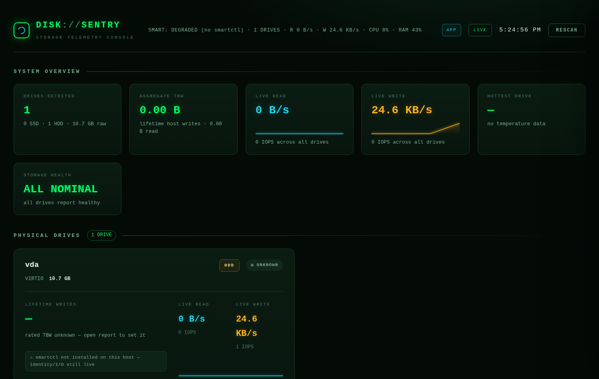

# DiskSentry

**A hacker-terminal-style desktop app that watches every drive you own — SSD, NVMe, HDD, external USB — in real time.**




DiskSentry runs as a **native Windows application** — its own window and
taskbar icon, no browser, no address bar, no console window behind it.
Everything is **100% local**: the app binds to `127.0.0.1` only and makes
zero network calls. Nothing leaves your machine.

---

## ✨ Features

- **All your drives, live** — SSD / NVMe / HDD / external USB: identity,
  capacity, temperature, health, real-time read/write throughput (1-second
  sampling), IOPS, busy%, session totals, history charts
- **Who is writing — and to WHICH disk** — the **TOP WRITERS** table ranks
  every running program by live write/read rate, session bytes and lifetime
  totals, then attributes each program to its target drive(s): your C: SSD
  vs. the external USB HDD. Click a row for its open file paths and per-drive
  split; a per-drive breakdown panel shows exactly where the writes go
- **SSD TBW & endurance** — lifetime host writes, rated-TBW budget bar, NAND
  life left, DWPD, GB/day average, burn-rate projection ("time until rated
  TBW at current write speed"), history that persists across restarts
- **Full S.M.A.R.T. health** — complete ATA attribute tables and NVMe health
  logs: reallocated / pending / CRC / media errors, power-on hours, power
  cycles, unsafe shutdowns
- **USB enclosures handled** — auto-probes USB-SATA bridge dialects
  (Innostor / JMicron / Cypress / Sunplus) and tells you honestly when an
  enclosure simply doesn't forward SMART
- **Honest engineering** — exact kernel counters vs. estimated process
  attribution are shown side by side; nothing is silently faked
- **Zero setup** — one self-contained `.exe`, per-user config, no install

## 🚀 How to use

1. **Download** `DiskSentry.exe` from the
   [**Releases**](../../releases) page
2. **Double-click it** → accept the **Administrator (UAC) prompt**
   (reading raw SMART data requires elevation on Windows — the same reason
   CrystalDiskInfo asks for it)
3. **That's it.** A real app window opens. **Close the window to quit** —
   a TBW history snapshot is saved on exit.

> ⚠ **First-run warning — SmartScreen.** Because the exe is not
> code-signed, Windows may show *"Windows protected your PC"*. Click
> **More info → Run anyway**. This is normal for unsigned open-source
> executables. Don't trust it? [Build it yourself](#-build-from-source)
> from this source in ~2 minutes.

**Requirements:** Windows 10/11 64-bit and an administrator account.
No Python needed, no browser needed, nothing to install — the exe is fully
self-contained (Windows 11 ships the WebView2 runtime built in; if it is
ever missing, DiskSentry automatically opens in your default browser
instead — you are never left stranded).

### Want the full SMART table and exact TBW?

Install **smartmontools** once:

```
winget install smartmontools
```

(Default install path is auto-detected, PATH not required.) Then press
**RESCAN** inside DiskSentry. Without smartmontools you still get all
drives, health, temperature and **all live I/O** via PowerShell reliability
counters — but the full attribute table and exact TBW numbers need smartctl.

## ⌨ Command line

| Flag | Effect |
|---|---|
| *(none)* | native app window (default) |
| `--port 9000` | use another port (default 8765; if busy, a free one is picked automatically) |
| `--browser` | open the dashboard in your default browser instead of the app window |
| `--no-browser` | server only — nothing opens |
| `--sim` | demo mode with 5 simulated drives |

Boot log of the windowed exe: `%LOCALAPPDATA%\DiskSentry\disksentry.log`.
Factory reset: delete `%LOCALAPPDATA%\DiskSentry\`.

## 🖥 Reading the dashboard

| Area | What it tells you |
|---|---|
| **SYSTEM OVERVIEW** | drive count/capacity, aggregate TBW, live read/write totals, hottest drive, overall health |
| **PHYSICAL DRIVES** | one card per drive: identity, TBW endurance bar, life/DWPD/projection chips, live I/O, temp / power-on / cycles |
| **PROCESS I/O · TOP WRITERS** | which program is reading/writing how much — live rates, session + lifetime totals, filter/sort/top-N/group-by, **WRITING TO** chips showing the target disk per program, click-to-expand open file paths |
| **WHERE THE WRITES GO** | per-drive breakdown: exact kernel write rate, estimated process-written share, % of all writes, top writer programs |
| **OPEN FULL REPORT** *(button on each drive card)* | 5-tab detail panel: Overview · SMART table (searchable) · Endurance/TBW (rated editor + accrual chart) · I/O charts (60s/5m/30m) · Identity |

Keyboard: `R` rescan · `Esc` closes the report panel.

## 🔒 Privacy

- Server binds to `127.0.0.1` only — no telemetry, no analytics, no updates
  phone-home, no network calls of any kind
- Config + TBW history live in `%LOCALAPPDATA%\DiskSentry\` (Windows) —
  delete that folder for a factory reset

## 📦 Build from source

> PyInstaller cannot cross-compile a Windows exe from Linux/macOS, so the
> build runs on your Windows machine — one double-click, ~2 minutes.

1. Install **Python 3.10+** from <https://www.python.org/downloads/>
   (tick **"Add python.exe to PATH"** on the first installer screen)
2. Double-click **`build_windows.bat`**
3. Your exe appears at **`build_out\DiskSentry.exe`** — copy it anywhere

Or run straight from source (no exe): double-click `start_windows.bat`, or
`pip install -r requirements.txt` then `python run.py`.
Works on Linux/macOS too (browser mode, drive I/O + SMART where available).

<details>
<summary><b>🩺 Troubleshooting</b> (click to expand)</summary>

| Symptom | Fix |
|---|---|
| SmartScreen: "Windows protected your PC" | **More info → Run anyway** (unsigned open-source exe) — or build it yourself |
| Antivirus flags the exe | PyInstaller one-file builds occasionally trip heuristics; build from source with `build_windows.bat` |
| "NO DRIVES DETECTED" | Accept the UAC prompt; run as Administrator |
| SMART says "smartctl not found / degraded" | `winget install smartmontools`, then press RESCAN |
| SMART tab: "Unable to detect device type" | Run as Administrator; check `smartctl -a /dev/pd0` in a terminal — DiskSentry shows the exact device it used under IDENTITY → SMART DEVICE |
| USB drive: "enclosure does not expose SMART" | The bridge chip ignores every pass-through dialect (hardware limitation). Everything else still works; a SAT-capable dock/enclosure unlocks full SMART |
| Temperature/Power-on shown but SMART table empty | That's the PowerShell reliability-counter fallback (works without smartctl) |
| TBW shows `—` | HDDs have no TBW; for SSDs install smartmontools + rescan |
| "N protected processes hidden" in TOP WRITERS | Some system processes hide I/O counters unless elevated — relaunch as Administrator |
| Process rates higher than disk throughput | Windows per-process I/O counters include file, network-socket and pipe traffic (same source as Task Manager); per-disk numbers are true disk counters |
| "WRITING TO" shows `—` or `hidden` | No open files attributed at the last scan, or the program hides its handles — run elevated; the 40 busiest programs are scanned every 4 s |
| Estimated process writes < exact disk writes | Expected — the gap is OS kernel I/O, cache flushes and protected processes. Windows has no per-process-per-disk counter without ETW, so both numbers are shown side by side |
| Port already in use | A free port is picked automatically, or force one: `DiskSentry.exe --port 9000` |
| Prefer the browser | `DiskSentry.exe --browser` |
| No window at all | WebView2 missing (rare) — the browser fallback already opened automatically; install the Evergreen runtime from <https://developer.microsoft.com/microsoft-edge/webview2/> for the native window |

</details>

<details>
<summary><b>✅ How this is tested</b> (click to expand)</summary>

- All 10 API endpoints exercised (live + sim, mode switching, rated-TBW save,
  rescan, history, events, per-process I/O)
- Real I/O verified end-to-end: a 150 MB direct write registered on the live
  telemetry pipeline
- **Per-process attribution verified end-to-end**: a live test wrote 60 MB
  from its own process — the tracker attributed exactly 62.9 MB to that PID's
  session column *and* attributed the sustained write stream to the drive the
  file lives on, with the open file path visible in the detail row
- **Windows SMART path covered by an offline emulator suite** (162
  assertions): a fake smartctl replicating real Windows 11 machines — an
  NVMe laptop (serial-formatting differences included) and an Innostor USB
  enclosure that only answers `-d sat,12` — verifies scan parsing, serial
  mapping, USB bridge dialect probing + persisted hints + negative caching,
  the PowerShell fallback and the full API surface
- **Native desktop shell suite** (25 checks): window URL/title/size verified
  with a fake webview while the backend is actually serving; a simulated
  WebView2 crash proves the browser fallback reuses the live backend;
  headless subprocesses prove the import-failure fallback chain end-to-end
- UI reviewed at 1600px and 390px: no horizontal overflow, zero console
  errors, keyboard navigation and reduced-motion respected

</details>

<details>
<summary><b>📁 Project layout</b> (click to expand)</summary>

```
run.py                 entry point (native app window shell + waitress server,
                       browser fallback chain, exe log-file mirroring)
app.py                 Flask API + dashboard route
monitor/
  disks.py             physical disk enumeration (Win PS / Linux sysfs+lsblk)
  smart.py             smartctl JSON engine + PowerShell fallback + USB probing
  io_monitor.py        1s I/O sampler, 30-min ring buffers, session totals
  process_io.py        per-process I/O tracker (top writers, rates + totals,
                       open-file -> drive attribution, by-drive rollup)
  endurance.py         TBW / rated / life / DWPD / projection math
  simulator.py         SIM mode engine (5 realistic drives)
  store.py             config + TBW history persistence
  context.py           monitor singleton, background refreshers
  util.py              subprocess/PowerShell/parsing helpers
templates/index.html   dashboard page
static/style.css       spacious hacker-terminal theme
static/app.js          dashboard application (polling, panel, tabs)
static/charts.js       canvas chart engine (offline, no CDN)
build_windows.bat      one-click EXE builder (run on Windows)
DiskSentry.spec        PyInstaller spec (icon + admin manifest + datas)
scripts/               offline Windows-path test suite (fake smartctl emulator)
screenshots/           images used by this README
```

</details>

<details>
<summary><b>🚁 Publishing a release</b> (for repo maintainers)</summary>

Two ways to get the exe onto the Releases page:

1. **Automatic (recommended)** — push a version tag; GitHub Actions builds
   the exe on a Windows runner and attaches it to a new Release:
   ```
   git tag v1.3.1
   git push origin v1.3.1
   ```
   (Workflow: `.github/workflows/build.yml`. Manual runs put the exe under
   the run's *Artifacts* instead.)
2. **Manual** — run `build_windows.bat` locally and upload
   `build_out\DiskSentry.exe` to a Release you create by hand.

Note: the exe is not code-signed, so SmartScreen will always show the
"unrecognized app" prompt to new users — the README warns them above.
Signing requires a certificate (OV ~$100–300/yr, EV ~$300+/yr).

</details>

## 📄 License

MIT — see [LICENSE](LICENSE). DiskSentry reads your drives through
psutil, smartmontools (optional) and Windows PowerShell; it never writes to
your disks (aside from its own config/TBW history in `%LOCALAPPDATA%`).
